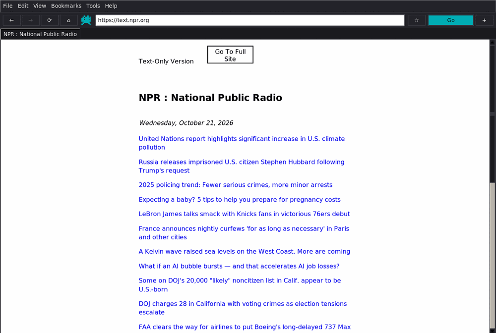
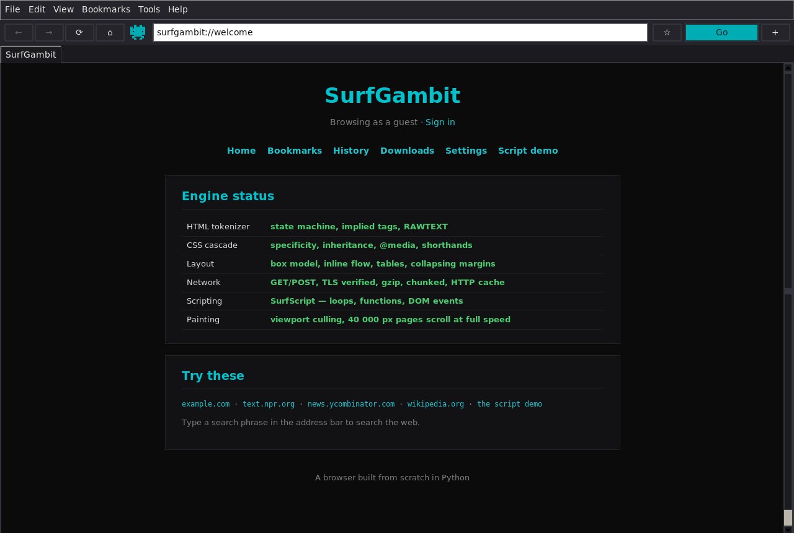
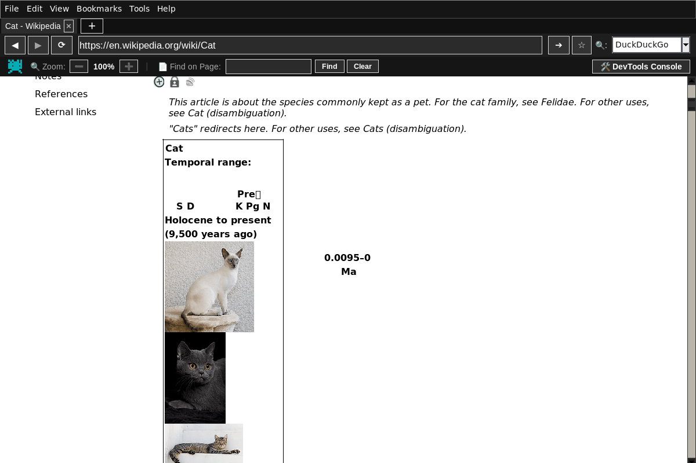
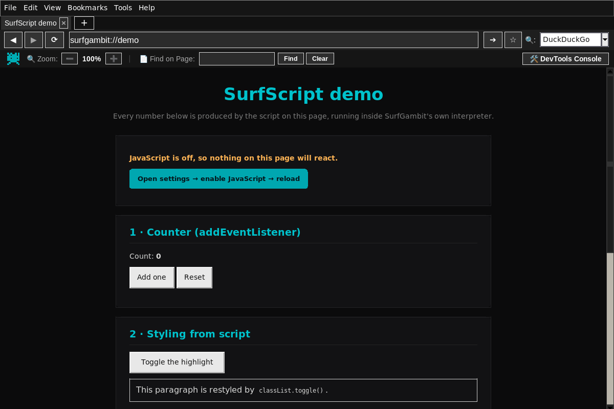
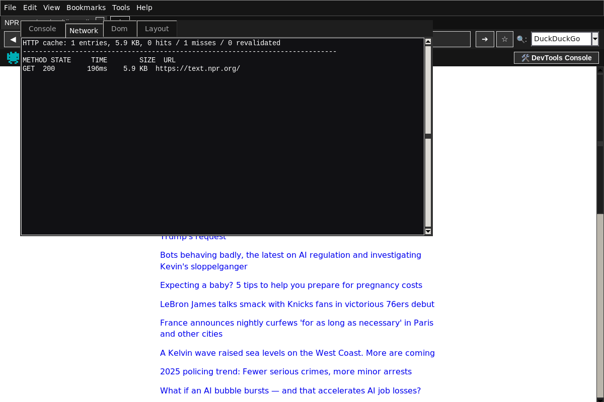
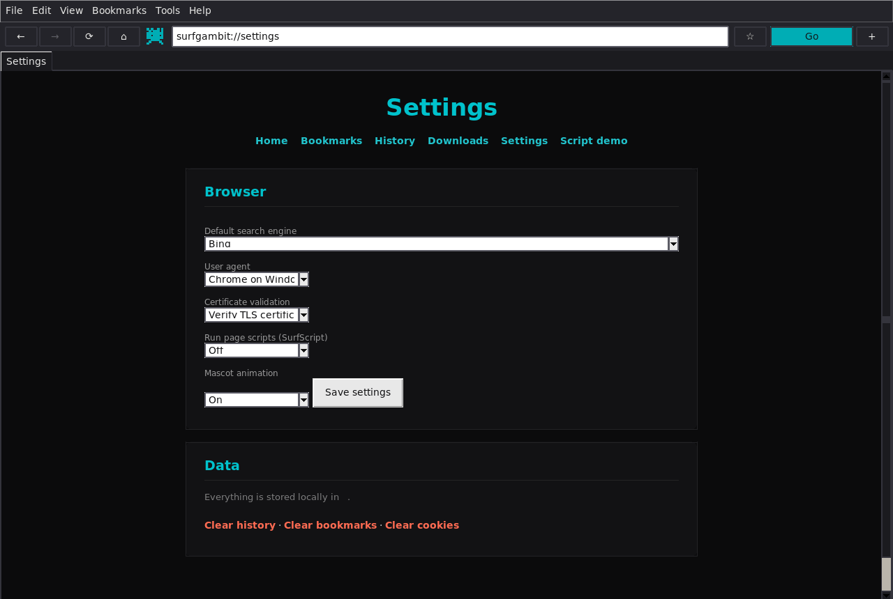

# 🌐 SurfGambit

> A web browser built completely from scratch in Python. No Chromium. No WebView. No borrowed
> rendering engines. Just raw sockets, a hand-written HTML/CSS parser, a layout engine, and a
> canvas renderer that paints every pixel itself.




<sub>text.npr.org &middot; real TLS, real cascade, real layout. No WebView.</sub>

---

## What is this?

SurfGambit is a desktop web browser that opens real internet connections, parses HTML character by
character, runs a real CSS cascade, solves layout geometry itself, and paints every pixel on screen
through its own rendering pipeline.

It is not fast and it is not Chrome. But every line is written from scratch, it is standard-library
only, and it renders real websites. The point of the project is to find out — concretely, in code —
what a browser actually does between a TCP socket and a lit pixel.

---

## How it works

```
URL  ──▶  HTTPClient (raw socket + TLS, gzip, chunked, redirects, disk cache)
     ──▶  Tokenizer  (state machine, implied tags, RAWTEXT/RCDATA, entities)
     ──▶  DOM        (iterative tree builder, safe on deeply nested pages)
     ──▶  Style      (CSS tokenizer, @media, selectors, specificity, inheritance)
     ──▶  Layout     (box tree: block, inline, table, flex, grid)
     ──▶  Renderer   (Tk canvas, viewport culling, form widgets)
```

Nothing is delegated. The only things the browser borrows are the operating system's socket
implementation, its TLS library, and Tk's drawing primitives.

---

## What is inside

**Transport**

- HTTP/1.1 over raw TCP, TLS verified by default, `GET` and `POST` (urlencoded and multipart)
- gzip/deflate, chunked transfer decoding, 10-hop redirects with correct method rewriting
- per-hop cookies and `Referer`, truncation detection, streamed downloads with progress and cancel
- an on-disk HTTP cache with `ETag` / `Last-Modified` revalidation, `304` handling and LRU eviction
- RFC 6265 cookie jar: domain matching, public-suffix rejection, path boundaries, `Secure`, expiry

**Parsing and style**

- spec-shaped HTML tokenizer: quoted attributes, comments, bogus tags, implied `html/head/body`,
  RAWTEXT and RCDATA elements, full entity decoding
- CSS tokenizer that survives comments, strings containing braces, nested `@media` / `@supports`,
  `!important`, shorthands, and every unit from `px` to `vh`
- external stylesheets fetched and cascaded alongside inline ones

**Layout and painting**

- block flow with collapsing margins, `auto` centring and `max-width`; inline flow with line boxes,
  baselines, justification and `white-space`; inline-block; tables with `colspan`; flexbox; CSS grid
- **viewport culling**: only the visible band of a page becomes canvas items, so a 40 000 px document
  scrolls as smoothly as a short one
- live form controls — text fields, passwords, checkboxes, selects, buttons — that move with the page

**Scripting — SurfScript**

A small JavaScript engine written for this browser: lexer, recursive-descent parser, tree-walking
interpreter, and a DOM binding onto the engine's own node tree.

```js
let total = 0;
document.querySelectorAll('.row').forEach(function (row) {
  total += Number(row.dataset.value);
});
document.getElementById('sum').textContent = 'Total: ' + total;
```

- language: `let/const/var`, `if/else`, `while`, `do`, `for (;;)`, `for…of`, functions and closures,
  arrays and objects, `&&`/`||`/ternary, bitwise and shift operators, regex literals, `new`, `typeof`
- built-ins: `Math`, `JSON`, `Date`, `RegExp`, `parseInt`/`parseFloat`, the usual string and array
  methods, `setTimeout`/`setInterval`
- DOM: `querySelector(All)`, `createElement`, `appendChild`, `classList`, `style`, `dataset`,
  attributes, bubbling events, `preventDefault`/`stopPropagation`, inline `onclick`
- sandboxed: every script runs under a step and wall-clock budget, with no network or filesystem
  access. It is intentionally a subset — no `class`, `async/await`, modules or `eval`

**Browser**

- tabs with independent back/forward history, find-in-page, zoom that re-lays-out the page
- bookmarks, history, downloads and local profiles behind `surfgambit://` pages
- download manager with live progress and cancel; developer tools with a script console REPL,
  a network panel (status, time, bytes, cache hits) and a DOM/layout inspector
- text selection and copy, right-click link and image menus, view source, save page
- dark, consistent chrome on every platform, and a small offline game for when the network is down

---

## Getting started

**Requirements:** Python 3.9+ with Tk. Nothing to `pip install`.

```bash
git clone https://github.com/Yash-Tripath1/SurfGambit.git
cd SurfGambit
python browser.py
```

Open a URL straight from the command line:

```bash
python browser.py https://news.ycombinator.com
```



<sub>The start page: engine status, quick links, and a search box that is really just the address
bar.</sub>

If Tk is missing: `sudo apt install python3-tk` (Debian/Ubuntu) or
`sudo dnf install python3-tkinter` (Fedora). It ships with the python.org installers on Windows and
macOS.

**Windows executable:** download `SurfGambit.exe` from the releases page, or build it yourself with
`pyinstaller SurfGambit.spec`. Windows Defender may flag it — it is an unsigned PyInstaller binary,
which is a known false positive.

---

## Project layout

```
SurfGambit/
├── browser.py              # entry point
├── core/                   # engine (no UI imports)
│   ├── dom/                # tokenizer, tree builder, DOM node
│   ├── style/              # CSS tokenizer, selector engine, cascade
│   ├── layout/             # box tree, block, inline, table, flex, grid
│   ├── net/                # HTTPClient, HTTPCache, RFC 6265 CookieJar
│   ├── js/                 # SurfScript interpreter + DOM bridge
│   ├── accounts.py         # local profiles (PBKDF2)
│   ├── storage.py          # per-user data directory, atomic writes
│   ├── store.py            # settings, bookmarks, history, downloads
│   ├── downloads.py        # download queue
│   └── search.py           # address-bar parsing + image search
├── ui/                     # Tk layer
│   ├── app.py              # window, menus, tabs, devtools, thread pool
│   ├── tab.py              # navigation, loading, painting, script events
│   ├── renderer.py         # canvas painter with viewport culling
│   ├── pages.py            # surfgambit:// pages
│   ├── mascot.py           # the alien
│   └── game.py             # Alien Defender
├── parser.py layout.py network.py cookies.py accounts.py
│   css_compiler.py surfscript.py game.py      # compatibility shims
├── docs/                   # architecture notes and screenshots
├── tests/                  # self-checks (python -m tests.run)
└── .github/workflows/      # continuous integration
```

Browser data lives outside the repository:

| OS | Location |
| --- | --- |
| Windows | `%APPDATA%\SurfGambit` |
| macOS | `~/Library/Application Support/SurfGambit` |
| Linux | `$XDG_DATA_HOME/surfgambit` (usually `~/.local/share/surfgambit`) |

Set `SURFGAMBIT_DATA_DIR` to override it.

---

## What it can handle

Works reasonably well:

- text-first sites (Hacker News, text.npr.org, example.com)
- Wikipedia, including the Vector skin's grid layout
- documentation sites and blogs with classic CSS
- GitHub's marketing pages

Deliberately out of scope:

- `position: absolute/fixed`, `float`, transforms, animations, container queries
- WebP/AVIF decoding (Tk only decodes PNG, GIF, PPM and PGM), audio and video
- WebSockets and HTTP/2 — the client speaks HTTP/1.1
- a complete JavaScript engine: SurfScript is a documented subset, and sites whose scripts depend on
  the rest of the language render better with scripting switched off. **View → Reload without
  scripts** (`Ctrl+Shift+R`) always gives the plain rendering

If a page looks wrong, that is usually the honest boundary of the engine rather than a crash — the
browser reports script errors in the developer console instead of failing silently.

---

## Keyboard shortcuts

| Keys | Action |
| --- | --- |
| `Ctrl+T` / `Ctrl+W` | new tab / close tab |
| `Ctrl+L` | focus the address bar |
| `Ctrl+R` / `F5` | reload |
| `Ctrl+Shift+R` | reload without running page scripts |
| `Ctrl+F` | find in page |
| `Ctrl+J` | download manager |
| `Ctrl+D` | bookmark this page |
| `Ctrl+U` | view source |
| `Ctrl+S` | save page |
| `Ctrl` `+` / `-` / `0` | zoom in / out / reset |
| `Alt+←` / `Alt+→` | back / forward |
| `F11` / `F12` | full screen / developer tools |
| `Ctrl+Q` | quit |

---

## Tests

```bash
python -m tests.run            # no network, no display needed
python -m tests.run js cache   # a subset by group
python -m tests.run --verbose
```

The suite covers the DOM and tokenizer, the cascade, layout geometry, cookies, the HTTP client and
cache, painting and culling maths, the script interpreter, accounts, storage, the download manager and
the compatibility shims. It forces a temporary `SURFGAMBIT_DATA_DIR`, so it can never touch a real
profile. Continuous integration runs it on several Python versions on every push.

---

## Screenshots

| | |
| --- | --- |
|  |  |
| Wikipedia's Vector layout, culled to the visible band | `surfgambit://demo` — counters, timers, DOM building |
|  |  |
| Console REPL, network panel and cache stats | Settings, including the scripting switch |

---

## Why build this?

To understand how browsers actually work — not at a "it parses HTML" level, but at a "here is exactly
how a raw TCP socket turns into pixels on a screen" level.

---

## Built with

- Python 3 standard library only: `socket`, `ssl`, `tkinter`, `gzip`, `zlib`, `hashlib`, `threading`,
  `urllib.parse`
- Zero external dependencies

---

## License

MIT — see [LICENSE](LICENSE).

*Made by Anadi Tripathi*
